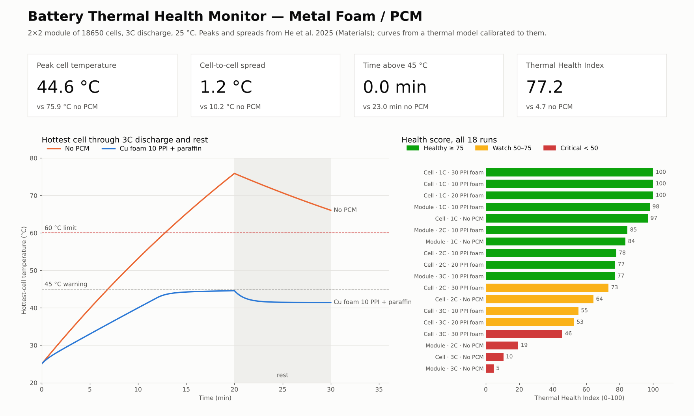

# Battery Thermal Health Monitoring — Metal Foam / PCM Data Warehouse

An end-to-end data-engineering project: **published experimental measurements on metal-foam /
phase-change-material (PCM) battery cooling → Python ETL → SQL star-schema warehouse →
thermal-health KPI layer → Tableau extracts + web dashboard.** It is built so your own lab
logs (e.g. a 4×2 or 3×2 module) drop straight into the same pipeline.



*At 3C discharge, a 10 PPI copper-foam/paraffin composite held a 2×2 18650 module at 44.6 °C instead of 75.9 °C
without PCM, and cut the cell-to-cell spread from 10.2 °C to 1.2 °C (published values, He et al. 2025). Curves are
from a thermal model calibrated to those values. Every number is derived step by step in the
[calculation workbook](docs/CALCULATION_WORKBOOK.md).*

Built with Claude Code.

## Quick start (Windows / macOS / Linux)

```bash
# 1. Python 3.10+  (no database server needed: SQLite ships with Python)
pip install -r requirements.txt
# 2. Build everything (~1 minute)
python run_pipeline.py
# 3. Run the tests
python -m pytest -q
# 4. Try the SQL
python -m etl.query sql/03_analysis_queries.sql
python -m etl.query "SELECT run_id, peak_c, thermal_health_index FROM vw_run_kpi"
```

To browse the warehouse with a GUI, install **DB Browser for SQLite** (free) or **DBeaver** and open
`data/warehouse/battery_thermal_dw.sqlite`. For Tableau, open
`data/exports/tableau/battery_thermal_health.hyper` (see `docs/TABLEAU_GUIDE.md`).

## Architecture

```
data/raw/literature/*.csv ─┐            ┌─ dim_source  dim_pack  dim_cell
data/raw/lab_logs/*.csv  ──┤  EXTRACT   │  dim_tms  dim_condition  dim_metric  dim_threshold
                           │  (manifest │
                           ▼   + sha256)│  fact_reported_measurement  (46 published numbers)
                     TRANSFORM          │  fact_reported_relative     (7 published % reductions)
           validate (20+ DQ checks) ───►│  fact_run                   (18 calibrated runs + lab runs)
           conform to dimensions        │  fact_thermal_log           (10,116 temperature samples)
           reconstruct time series      │  etl_batch, etl_file_manifest, dq_check_result
                           ▼            └─ KPI views: vw_run_kpi, vw_cell_run_kpi, vw_run_spread_ts,
                         LOAD  (SQLite star schema)   vw_foam_effectiveness_runs, vw_reported_kpi,
                           ▼                          vw_reported_foam_vs_baseline
                        EXPORT ─► Tableau .hyper + CSV ─► web dashboard JSON/CSV
```

| Concept | Where |
|---|---|
| Relational schema, PK/FK, CHECK constraints | `sql/01_schema.sql` |
| Star schema (facts at declared grain + conformed dimensions) | `sql/01_schema.sql` |
| KPI/semantic layer as SQL views, window functions (LEAD) | `sql/02_kpi_views.sql` |
| Analytical SQL examples | `sql/03_analysis_queries.sql` |
| ETL stages | `etl/extract.py`, `etl/transform.py`, `etl/load.py`, `etl/export.py` |
| Data quality gate (FAIL blocks the load) | `etl/transform.py` (`DQ`), table `dq_check_result` |
| Data lineage & audit | `etl_batch`, `etl_file_manifest`, `fact_run.anchor_meas_id` |
| Physics model for time-series reconstruction | `etl/thermal_model.py`, `etl/reconstruct.py` |

## Thermal-health KPIs

| KPI | Definition |
|---|---|
| Peak temperature `peak_c` | maximum cell surface temperature in the run |
| Cell-to-cell spread `dt_max_c` | max over time of (hottest − coldest cell), modules only |
| Time above 35 / 45 / 60 °C | seconds above optimal / warning / critical thresholds |
| Max heating rate | °C per minute, from consecutive samples (LEAD window) |
| PCM melted % | peak paraffin liquid fraction: how much latent reserve was used |
| Peak reduction / rise suppression | foam run vs no-PCM run, same pack, rate and ambient |
| **Thermal Health Index (0–100)** | 50% peak score + 20% exposure score + 30% uniformity score |
| Health band | Healthy ≥ 75, Watch 50–75, Critical < 50 |

Thresholds live in `dim_threshold` (`data/raw/literature/thresholds.csv`), so you can change a limit and re-run.

## Where the data comes from (and what is measured vs modelled)

Read `docs/METHODOLOGY.md`. In short:

* **Measured (published)**: every number in `fact_reported_measurement` / `fact_reported_relative`
  is copied from an open-access paper, with the paper, condition and wording recorded.
* **Model-reconstructed**: papers publish peaks, not raw logs. For the one study with matched
  baseline and metal-foam peaks for a single cell *and* a 2×2 module (He et al. 2025, *Materials*),
  a lumped thermal model is calibrated so each simulated run hits the published peak (and module ΔT)
  within 0.05 °C. These curves are flagged `data_origin = 'model_reconstructed'`.
* **Your lab data**: anything in `data/raw/lab_logs/` loads as `data_origin = 'lab_measured'`.

## Adding your lab logs

See `data/raw/lab_logs/README.md`. Add your pack to `packs.csv`, your foam/PCM to
`tms_materials.csv`, drop the CSV(s) in `data/raw/lab_logs/`, run `python run_pipeline.py`.
